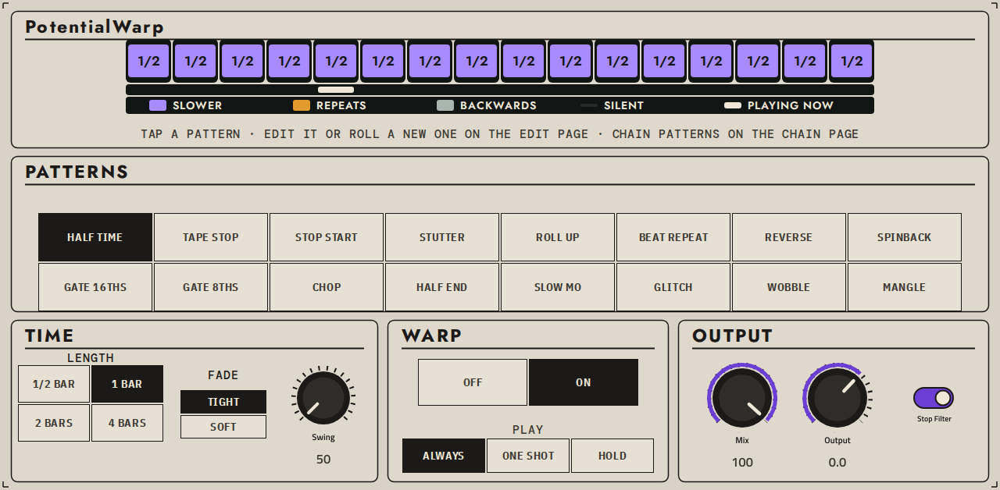

# PotentialWarp

**Bend time on the beat.** A tempo-locked mangler for your MPC, in the spirit of Gross Beat: tap one of 16 patterns and whatever runs through it stutters, drops to half speed, runs down like a stopped tape, spins back, plays backwards or gates in time with your beat. Made for breaks, loops and experimental sample flips.

*Insert effect · MPC OS 3.x · Gen1 and Gen2 · v1.0.1*

Free and open source (MIT), made by **PotentialBreaks**. It runs inside the MPC like its own effects, with its own touchscreen page, Q-Link control and project recall, and no computer needed while you play.

**[Download the latest release](../../releases/latest)** · [Install guide](INSTALL-GUIDE.md) · [FAQ](FAQ.md) · [Ideas and bugs](../../issues/new/choose)

## What it does

It keeps the last few seconds of whatever you feed it and plays them back through a 16-step **pattern** locked to your sequence. Each step can:

| Move | What you hear |
|---|---|
| **Straight** | The sound as it is |
| **1/2, 1/4 speed** | Drops an octave (or two) and drags behind the beat |
| **Tape stop / start** | Slows to a stop, or spins up from silence |
| **Repeat** | Stutters a slice, from a whole 8th down to a 64th roll |
| **Backwards / Spin** | Plays the last moment in reverse, or a fast spinback |
| **Silent** | Gates the sound out |

| Control | What it does |
|---|---|
| **PATTERNS** | 16 one-tap pads (also in the MPC's PRESET menu): Half Time, Tape Stop, Stop Start, Stutter, Roll Up, Beat Repeat, Reverse, Spinback, Gate 16ths, Gate 8ths, Chop, Half End, Slow Mo, Glitch, Wobble, Mangle |
| **LENGTH** | How long the 16 steps last: **1/2 BAR**, **1 BAR** or **2 BARS** |
| **FADE** | **TIGHT** (short, punchy jumps) or **SOFT** (smoother) |
| **WARP** | **ON** / **OFF**. Automate it to drop the effect in and out |
| **MIX / OUTPUT** | Blend with the original sound, set the level |

The strip at the top shows the pattern you picked, coloured by move, with a light under the step that's playing now.

## How to use it

Add it as an **insert effect** on a track, program, pad or bus. It won't be in the instrument list. Press **Play**, then tap a pattern. Try **Half Time** or **Tape Stop** on a whole drum bus, **Stutter** or **Roll Up** on a break, **Reverse** on a vocal chop.

For a live feel, map **WARP** or **PATTERN** to a Q-Link and record the moves as automation.

## Three looks

PotentialWarp comes in three looks: **Print Plate** (the default), **Night Rack** and **Colour Block**. Open the **SETTINGS** page and tap one of the big LOOK keys. The new look shows the next time the plugin loads: take it off the track and add it again, or load your project again. Your choice is kept on your MPC for every project. The sound and the controls are the same in all three.

## Limitations

- **It follows the song position.** The patterns line up with your bars while the sequence plays. When it's stopped, it keeps its own time at the project tempo, so pads you play still get warped, but not lined up to a bar.
- **4/4 time.** One bar is four beats.
- **It can only use what it has already heard.** Every move starts at the start of its run, so nothing reaches into the future: "backwards" plays the moment just before, in reverse.
- **2 frames of delay** (0.05 ms), on the warped and the straight sound alike.
- **Tested on the computer only so far** (see below).

## Will it work on my MPC?

| | |
|---|---|
| **Tested on** | Nothing yet. It passes Akai's plugin checker and simulator, and my own tests |
| **Should work on** | Any standalone MPC on **MPC OS 3.10.1 or later** (Akai's plugin folder), Gen1 (32-bit) and Gen2 (64-bit). Also Gen1 MPCs with the community plugin set-up on MPC OS 3.x |
| **Not supported** | **MPC OS 2.x** |

If you try it, please [tell me how it went](../../issues/new/choose).

## Install

**👉 [Step-by-step install guide](INSTALL-GUIDE.md)**

The short version, on **MPC OS 3.10.1 or later**:
1. Download `PotentialWarp-<version>-akai-vst2.zip` from [**Releases**](../../releases) and unzip it on your computer.
2. On the MPC, turn on **Preferences → Enhancements (Beta) → Enable Enhancements** and **External Plugin Support**.
3. Copy the folder **PotentialBreaks - VST - PotentialWarp** into a folder called **VST2 Plugins** at the top of a USB stick, SD card or the internal drive, and restart.
4. It's in **External Plugins**, as an effect.

Stuck? The [**FAQ**](FAQ.md) covers the common problems.

## Ideas, bugs and criticism: all welcome

I make these for myself first, and I want them to be good for everyone else too, so **please tell me what you think**, including what you don't like.

- 💡 [Suggest a feature](../../issues/new?template=idea.yml)
- 🐛 [Report a bug](../../issues/new?template=bug.yml)

You don't need to be technical. Short messages are great. See [CONTRIBUTING.md](CONTRIBUTING.md) for more, including how to send code.

## Licence

MIT. See [LICENSE](LICENSE) and [THIRD_PARTY.md](THIRD_PARTY.md). Gross Beat is a trademark of Image-Line; PotentialWarp is not affiliated with it.
